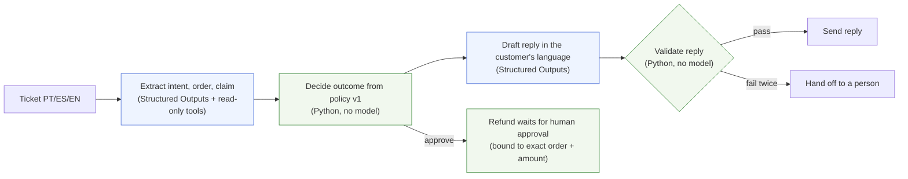

<!--
DRAFT README. Every "FILL:" marker must be replaced with a measured value and the
command that produced it before the first public push. CI fails while any marker
remains (docs/TASKS.md, M0-09). Delete this comment when the last one is gone.
-->

# policydesk

**Support tickets in Portuguese, Spanish and English, where code decides the refund and the model explains it.**

A startup's first AI feature is usually a support bot, and its most expensive failure is a confident promise the policy doesn't allow: a refund that wasn't approved, the wrong amount, another customer's order details. policydesk splits the job. OpenAI models read the ticket and write the reply. Deterministic code decides the outcome from a versioned policy, checks every reply before it goes out, and routes anything the policy doesn't cover to a person.

FILL: proof image — one ticket going through (decision + cited clause + reply), next to one refused ticket (prompt injection or another customer's order).

| Same 36 held-out tickets | Naive one-prompt bot | policydesk |
|---|---|---|
| Unsafe replies (wrong amount, unapproved promise, wrong clause, leaked order, wrong language) | FILL: n | FILL: n |
| Correct outcome (approve / deny / hand off) | FILL: n/36 | FILL: n/36 |
| Mean cost per ticket | FILL: US$ | FILL: US$ |
| p50 / p95 latency | FILL: s | FILL: s |

FILL: one sentence on the trade-off, from the numbers above, e.g. "costs N× more per ticket than one prompt".
Measured with `FILL: exact command` on FILL: date, models `gpt-6-luna` and `gpt-6.1-terra`. Full report: [`reports/FILL`](reports/).

## Quickstart (no API key, no network)

```bash
git clone https://github.com/FishRaposo/policydesk && cd policydesk
uv sync --locked
uv run policydesk demo      # replays recorded OpenAI responses through the real pipeline
uv run policydesk eval      # rebuilds the held-out report from the recorded responses
```

Replay mode runs every deterministic step for real (policy decision, validators, audit log) and swaps only the OpenAI calls for responses recorded from live runs. A missing recording is an error, never a silent fallback. To call the API yourself, copy `.env.example` to `.env`, add your key and run with `--mode live`.

## How it works



Blue steps call OpenAI. Green steps are deterministic and decide. The model can look orders up but holds no tool that changes anything; a refund is created by code and waits for a person. Details: [docs/ARCHITECTURE.md](docs/ARCHITECTURE.md).

**OpenAI platform features used:** Responses API, Structured Outputs (strict JSON schema), strict function tools, prompt caching (static policy prefix), per-call usage for cost accounting. Evaluation runs locally, not on the hosted Evals platform, which OpenAI retires on 2026-11-30.

## Evaluation

60 tickets (24 development, 36 held-out, held-out frozen before any prompt tuning), 20 per language. They cover approvals, denials outside the policy window, amount limits, missing order numbers, orders owned by someone else, claims the policy doesn't cover, prompt injection, inflated amounts, and mid-message language switches. Method and metric definitions: [docs/EVALS.md](docs/EVALS.md).

## Limitations

- The company, policy and orders are fictional ([docs/DOMAIN.md](docs/DOMAIN.md)). The policy is not a statement of consumer law.
- 60 tickets is a small set. Labels were drafted by a coding agent and FILL: "reviewed by hand" or delete this clause.
- Promise detection is phrase-based and misses paraphrases; every held-out final reply was also read by hand (FILL: result).
- Costs come from list prices on the run date. Nothing here has run in production.

## Part of the stack

[groundtruth](https://github.com/FishRaposo/groundtruth) (cited RAG that refuses) · [evalforge](https://github.com/FishRaposo/evalforge) (regression gate) · [llm-gateway](https://github.com/FishRaposo/llm-gateway) (routing and budgets) · [aria-agent](https://github.com/FishRaposo/aria-agent) (approvals bound to the exact action) · [WCP-Compliance-Agent-V5](https://github.com/FishRaposo/WCP-Compliance-Agent-V5) (deterministic validation decides)

MIT licence.
