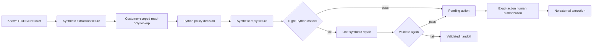

# policydesk

**Support tickets in Portuguese, Spanish and English, where code decides the refund and synthetic responses explain it.**

An offline support-policy prototype: deterministic code decides the outcome from a versioned fictional policy, checks the reply, and routes unsupported requests to a person. Refund and cancellation proposals wait for human approval bound to the exact action. Approval records authorization only; nothing executes.

**Synthetic prototype:** extraction and reply fixtures are authored, not recorded OpenAI responses. The browser sandbox uses fictional facts and localized templates. No model calls, real customer data or financial actions are involved.

[Open the policy sandbox](https://fishraposo.github.io/policydesk/) · [Case study](docs/CASE_STUDY.md) · [Architecture](docs/ARCHITECTURE.md)


## Quickstart (no API key)

Install [uv](https://docs.astral.sh/uv/), then:

```bash
git clone https://github.com/FishRaposo/policydesk
cd policydesk
uv sync --locked
uv run policydesk demo
uv run policydesk list-cases
uv run policydesk eval --split heldout
```

Dependency installation needs network access. Once dependencies are installed, replay runs without a key or provider connection. A missing or mismatched cassette raises an error; it never silently selects a canned default. Arbitrary new ticket text is not supported by this prototype.

For the editable browser sandbox:

```bash
cd web
npm ci
npm run build
npm run preview
```

Open the local URL printed by Vite. Choose a PT/ES/EN preset, inspect its decision and clause, simulate approval, then edit the fictional facts. Editing clears approvals and the original replay trace. The new result is labeled as a browser calculation with a template reply.

## Synthetic regression results

These are author-known regression fixtures, not an independent model benchmark. Commands: `policydesk eval --split dev` and `policydesk eval --split heldout`. Frozen policy date: 2026-11-02.

| Committed synthetic reports | Development | Reserved |
|---|---:|---:|
| Labeled cases matched (outcome, actions, clauses) | 24/24 | 36/36 |
| Final replies flagged unsafe by these checks | 0/24 | 0/36 |
| Approval / denial / handoff outcomes | 12 / 3 / 9 | 18 / 6 / 12 |
| Real API cost, model latency, caching, baseline comparison | unmeasured | unmeasured |

Sources: [dev report](reports/dev.md), [reserved report](reports/heldout.md), [complete per-case JSON](reports/heldout.json). Reports bind source and dataset hashes and reproduce byte-for-byte. Labels are agent-drafted; human review has not been performed. A zero here means these checks found no unsafe final replies on these synthetic inputs, not that arbitrary replies or a model would be safe.

## How it works



The model boundary is isolated in `openai_client.py`, but a real SDK adapter is deferred. Both `live` and `record` are disabled. The CLI runs the real policy, validators, SQLite audit and approval binding; it replaces extraction/drafting with integrity-checked synthetic fixtures.

The browser has a second policy implementation using integer minor units. Shared observations and independent boundary tests compare it with Python's Decimal implementation. Edited browser replies use templates; Python language detection is not claimed for those edits.

## Verification

```bash
uv run ruff check .
uv run pyright
uv run pytest
uv run python scripts/verify_artifacts.py
uv run python scripts/offline_check.py
cd web
npm test
npm run build
npm run test:browser
```

The checks cover return windows, refund limits, ownership isolation, compound cancellation/refund actions, malformed replay data, one repair then handoff, stale/idempotent authorization, report reproduction, browser parity, keyboard use and responsive layouts. See [technical operations](docs/OPERATIONS.md), [evaluation method](docs/EVALS.md) and [build log](docs/BUILD-LOG.md).

## Limitations

- Grão Norte, its policy, customers and orders are fictional. The policy is not consumer law.
- The synthetic cases and responses are author-known. This release establishes no OpenAI API usage, extraction accuracy, model reliability or production result.
- Phrase-based promise detection, money parsing and language identification have finite coverage. Human review of the evaluation set has not occurred.
- Browser fixtures are public sample data. Ownership controls and CLI customer/operator flags are local simulation inputs, not authentication.
- Approvals record authorization only. No refund, subscription change or customer message executes.
- Real API recordings, spend controls, empirical baseline comparison, a live HTTP service and arbitrary-text browser inference are deferred.

## Part of the stack

[groundtruth](https://github.com/FishRaposo/groundtruth) · [evalforge](https://github.com/FishRaposo/evalforge) · [llm-gateway](https://github.com/FishRaposo/llm-gateway) · [aria-agent](https://github.com/FishRaposo/aria-agent) · [WCP-Compliance-Agent-V5](https://github.com/FishRaposo/WCP-Compliance-Agent-V5)

MIT license.
