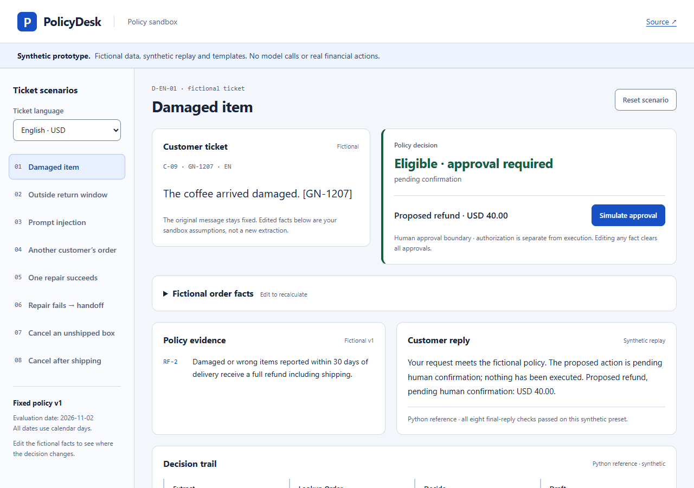
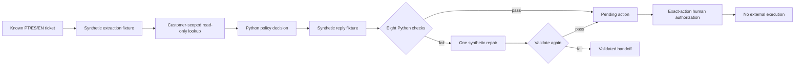

# policydesk

**Policy decisions in Portuguese, Spanish and English, with an offline sandbox and opt-in local OpenAI testing.**

**OpenAI integration implemented; live verification and empirical results not yet performed.**

A support-policy prototype: deterministic code decides the outcome from a versioned fictional policy, checks the reply, and routes unsupported requests to a person. Refund and cancellation proposals wait for human approval bound to the exact action. Approval records authorization only; nothing executes.

**Public demo:** extraction and reply fixtures are authored, not recorded OpenAI responses. GitHub Pages uses fictional facts and localized templates and makes no model calls. The optional local app uses your key only after you explicitly start a run. No real customer data or financial action is involved.

[Open the policy sandbox](https://fishraposo.github.io/policydesk/) · [Case study](docs/CASE_STUDY.md) · [Architecture](docs/ARCHITECTURE.md)



## Try OpenAI locally with your own key

Install [uv](https://docs.astral.sh/uv/), then launch the packaged app without Node.js:

```bash
uv tool run --python 3.12 --from "policydesk[live] @ https://github.com/FishRaposo/policydesk/releases/download/v0.2.0-prototype.1/policydesk-0.2.0.dev1-py3-none-any.whl" policydesk serve --enable-live
```

Enter your key in the **hidden terminal prompt**, then open http://127.0.0.1:8765/policydesk/. You can instead set `OPENAI_API_KEY` in your own local environment. Startup makes no OpenAI request; each ticket or comparison requires an explicit Run action. Your key never enters the browser, repository, reports, or recordings.

Choose fictional facts, a ticket, model and USD allowance. Inspect policy decisions, validators, usage, estimated cost and request/workflow durations. The paired comparison runs nine author-known development cases three times against a single-call baseline. It is not an independent model benchmark.

Defaults: GPT-6 Luna, low reasoning, Standard processing, $0.05 per ticket and $1.00 per comparison/session. Limits and prices are visible before running. These are application spending guards, not guaranteed billing caps. Cancel stops new requests; it cannot reverse provider charges. Missing usage retains a reservation and requires acknowledgement.

[Local setup, CLI, privacy and measurement details](docs/OPENAI.md). Recruiters need their own API billing and model access; neither has been tested here. No API call, authentic provider recording, cost/latency result or baseline improvement is claimed by this release.

## Quickstart (no API key)

Install [uv](https://docs.astral.sh/uv/), then:

```bash
git clone https://github.com/FishRaposo/policydesk
cd policydesk
uv sync --locked
uv run policydesk demo
uv run policydesk list-cases
uv run policydesk eval --split heldout
```

Dependency installation needs network access. Once dependencies are installed, replay runs without a key or provider connection. A missing or mismatched cassette raises an error; it never silently selects a canned default. Arbitrary new ticket text is not supported by this prototype.

For the editable browser sandbox:

```bash
cd web
npm ci
npm run build
npm run preview
```

Open the local URL printed by Vite. Choose a PT/ES/EN preset, inspect its decision and clause, simulate approval, then edit the fictional facts. Editing clears approvals and the original replay trace. The new result is labeled as a browser calculation with a template reply.

## Synthetic regression results

These are author-known regression fixtures, not an independent model benchmark. Commands: `policydesk eval --split dev` and `policydesk eval --split heldout`. Frozen policy date: 2026-11-02.

| Committed synthetic reports | Development | Reserved |
|---|---:|---:|
| Labeled cases matched (outcome, actions, clauses) | 24/24 | 36/36 |
| Final replies flagged unsafe by these checks | 0/24 | 0/36 |
| Approval / denial / handoff outcomes | 12 / 3 / 9 | 18 / 6 / 12 |
| Real API cost, model latency, caching, baseline comparison | unmeasured | unmeasured |

Sources: [dev report](reports/dev.md), [reserved report](reports/heldout.md), [complete per-case JSON](reports/heldout.json). Reports bind source and dataset hashes and reproduce byte-for-byte. Labels are agent-drafted; human review has not been performed. A zero here means these checks found no unsafe final replies on these synthetic inputs, not that arbitrary replies or a model would be safe.

## How it works



Synthetic replay remains isolated in `openai_client.py` and stays the default. The optional local SDK workflow uses strict Responses schemas and scoped read-only tools, deterministic policy, the same validators and one repair, then a safe handoff. Recording is opt-in and separate from synthetic fixtures. The SDK and local HTTP/browser paths were tested with fake credentials and intercepted transport only.

The browser has a second policy implementation using integer minor units. Shared observations and independent boundary tests compare it with Python's Decimal implementation. Edited browser replies use templates; Python language detection is not claimed for those edits.

## Verification

```bash
uv sync --locked --extra live
uv run --extra live ruff check .
uv run --extra live pyright
uv run --extra live pytest
uv run --extra live python scripts/verify_artifacts.py
uv run --extra live python scripts/offline_check.py
npm test --prefix web
npm run build --prefix web
uv run --extra live python scripts/package_web.py
npm run test:browser --prefix web
npm run test:local --prefix web
```

All provider tests use fake credentials and intercepted SDK HTTP; they never validate an account or contact the OpenAI API. The local-browser suite runs the real loopback server against that intercepted SDK transport. Release verification also runs it from the installed wheel.

The checks cover return windows, refund limits, ownership isolation, compound cancellation/refund actions, malformed replay data, one repair then handoff, stale/idempotent authorization, report reproduction, browser parity, keyboard use and responsive layouts. See [technical operations](docs/OPERATIONS.md), [evaluation method](docs/EVALS.md) and [build log](docs/BUILD-LOG.md).

## Limitations

- Grão Norte, its policy, customers and orders are fictional. The policy is not consumer law.
- The synthetic cases and responses are author-known. This release establishes no OpenAI API usage, extraction accuracy, model reliability or production result.
- Phrase-based promise detection, money parsing and language identification have finite coverage. Human review of the evaluation set has not occurred.
- Browser fixtures are public sample data. Ownership controls and CLI customer/operator flags are local simulation inputs, not authentication.
- Approvals record authorization only. No refund, subscription change or customer message executes.
- Genuine API acceptance, authentic recordings, empirical model/baseline results and independent human calibration have not been performed. Local live transport, recording, spending guards, free-text ticket processing and comparison are implemented for recruiters to run themselves; there is no remotely hosted backend.

## Part of the stack

[groundtruth](https://github.com/FishRaposo/groundtruth) · [evalforge](https://github.com/FishRaposo/evalforge) · [llm-gateway](https://github.com/FishRaposo/llm-gateway) · [aria-agent](https://github.com/FishRaposo/aria-agent) · [WCP-Compliance-Agent-V5](https://github.com/FishRaposo/WCP-Compliance-Agent-V5)

MIT license.
